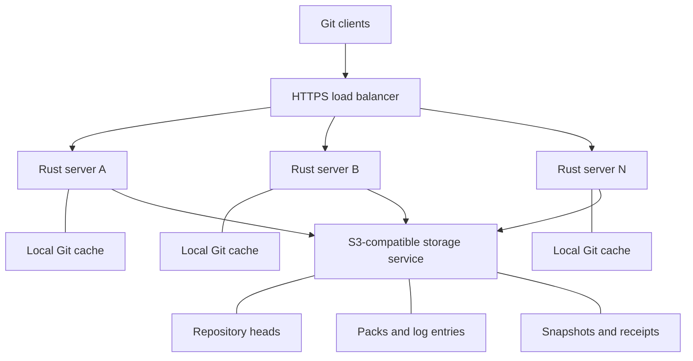

# lager design

Status: proposed design. Date: September 27, 2026.

The server does not exist yet. The design includes requirements for the implementation.

Use the [implementation plan](IMPLEMENTATION_PLAN.md) to build the server.

## 1. Purpose

Build a Git server in Rust. Use an S3-compatible service to store repository data. Run the same server program locally or on several Linux computers.

Users keep their standard Git clients. More servers increase the total capacity and the capacity for reads. Each repository has one ordered sequence of changes.

This document specifies our proposed implementation.

## 2. Technical terms

Use these terms with the meanings below.

| Term | Meaning |
|---|---|
| Storage service | The S3-compatible service that holds the permanent repository data. |
| Cache | A local repository copy that the server can replace. |
| Git object | A Git commit, tree, file content object, or tag object. |
| Pack | A file that contains Git objects in compressed form. |
| Thin pack | A pack that needs other objects to reconstruct some of its contents. |
| Ref | A Git name, such as a branch name, that points to an object. |
| OID | The identifier of a Git object. |
| Transaction | A group of changes that the server accepts or rejects together. |
| Atomic change | A change that becomes visible as one complete operation. |
| WAL | Write-ahead log. This log records repository changes before the server reports success. |
| Log entry | A record in the WAL. This record is different from a Git commit. |
| Repository head | The storage object that identifies the current log entry and snapshot. It is different from Git `HEAD`. |
| Generation | The sequence number of a repository state. Each change increases this number. |
| ETag | A value from the storage service that identifies an object version for conditional requests. |
| CAS | Compare-and-swap. This operation changes an object only if its ETag still equals the expected ETag. |
| Snapshot | A saved repository state that permits recovery without all earlier log entries. |
| Compaction | A process that combines packs to reduce the work necessary for reads and recovery. |
| Receipt | A saved record of a request result. |
| UUID | A unique identifier for a repository, request, or record. |
| Tombstone | A saved record that marks a repository as deleted. |
| Controller | The Rust component that controls access to one local repository. |
| Hook | A program that Git calls at a specified point in an operation. |
| Quarantine | A temporary area for received Git objects before Git accepts them. |

Product names, commands, code names, and file names retain their technical meanings.

## 3. System arrangement



Each server contains the HTTP interface, repository controllers, Git process control, and cache control. Each server has a separate cache directory. All servers use the same storage service.

Local operation needs one server and one local S3-compatible service. The local setup uses the same storage interface as the production setup.

Any server can receive a push. The storage service decides which conditional change succeeds. The request route does not give a server exclusive permission to write.

Later, separate HTTP servers can send work to Git servers. This change does not change the storage rules.

## 4. Functions and requirements

| Function | Requirement |
|---|---|
| Client connection | Use Git smart HTTP over HTTPS. Permit HTTP on the loopback address for local development. |
| Git operations | Support repository creation, clone, fetch, and push. |
| Refs | Support branch and tag creation, change, and deletion. Support the default branch. |
| Push rules | Check normal branch updates. Permit force pushes only with permission. |
| Multiple refs | Support atomic pushes. Initially, reject the complete push if any requested change fails a check. |
| Object format | Start with SHA-1. Save the format explicitly to permit later SHA-256 support. |
| Recovery | Recover a repository after loss of one cache or all caches. |
| Capacity | Add servers without a change to the client or storage format. |
| Maintenance | Support snapshots, compaction, cache removal, and safe removal of obsolete stored data. |

The server reports push success only after the storage service holds all required data and the new repository head.

A read that starts after a successful push must include that push or a later state. A read that overlaps a push can use the earlier state.

A Git fetch can use several HTTP requests. Check the repository head for each request. Do not claim that all requests use one fixed state. An old request can require a client retry.

If the storage service is unavailable, fail new reads and writes. Do not use an unchecked cache. A read that already selected a valid state can finish.

The storage service determines protection against permanent data loss. A local service on one disk does not provide redundant storage.

Git LFS, partial clone, user hooks, and SHA-256 remain later extensions. Transactions across repositories remain a later extension. Pull requests within one repository are in [decision 19](docs/decisions/0019-pull-requests.md). Git over SSH is in [decision 22](docs/decisions/0022-git-over-ssh.md). Passkey sign-up is in [decision 23](docs/decisions/0023-passkey-sign-up.md). Read-only mirrors of GitHub repositories are in [decision 20](docs/decisions/0020-github-mirrors.md), their pull requests in [decision 26](docs/decisions/0026-github-pull-requests.md), and their live updates in [decision 27](docs/decisions/0027-live-github-mirrors.md).

## 5. Storage interface

Require these operations from every storage service:

1. Read the current object after an accepted change.
2. Create an object only if the object does not exist.
3. Replace an object only if its ETag equals the expected ETag.
4. Store complete files without subsequent changes to those files.
5. Report a conditional-write conflict separately from a connection failure.

Require the provider's documented guarantees for these operations. S3 compatibility alone is insufficient.

AWS specifies `If-Match` and `If-None-Match` for conditional writes. These operations provide the reference behavior for the interface. See [S3 conditional writes](https://docs.aws.amazon.com/AmazonS3/latest/userguide/conditional-writes.html).

Do not use an ETag as a file checksum. Calculate a separate SHA-256 checksum for each stored pack.

Use this object arrangement:

```text
repos/<repository-id>/head.json
repos/<repository-id>/entries/<entry-id>.json
repos/<repository-id>/packs/<sha256>.pack
repos/<repository-id>/snapshots/<snapshot-id>.json
repos/<repository-id>/receipts/<receipt-id>.json
```

Only `head.json` changes in place. All other records retain their original contents.

Use a UUID as the repository identifier. Keep the name-to-UUID table separate. Use a configuration file for this table initially. Add a repository catalog and an identity service for production.

Never use a client path directly as a disk path or storage key.

### Repository head

Save these fields:

| Field | Purpose |
|---|---|
| Format version | Identifies the record format. |
| Repository UUID | Identifies the repository. |
| Incarnation UUID | Identifies this repository lifetime. |
| Revision UUID | Changes for every head update, even if the refs do not change. |
| Generation | Orders all push and maintenance changes. |
| Entries | Lists every entry after the snapshot base, oldest first. The last one is the latest entry. |
| Snapshot | Points to an optional snapshot and its base entry. |
| Object format | Identifies SHA-1 or a later supported format. |
| State | Identifies an active or deleted repository. |

The head is the index of the log. Only the index orders entries. Keep the head small: it lists only the entries after the snapshot base, and snapshots keep that list short. Do not add a ref table to it.

Create the head with a conditional request. After creation, use only CAS to change it. Mark deletion with a tombstone. Do not delete the head to reset its history.

If a user creates another repository with the same name, assign a new repository UUID. Delayed requests must not restore a deleted repository.

### Log entry and snapshot

A log entry contains these data:

- Format version, repository UUID, and incarnation UUID.
- Entry UUID and generation.
- Request UUID and checksum of the request contents.
- Operation type: push, snapshot, default-branch change, deletion, merge of a pull request, or a move of pull request refs ([decision 19](docs/decisions/0019-pull-requests.md)).
- Each ref name, expected old OID, and new OID.
- Each pack key, checksum, and byte count.
- User identifier, permission-rule version, and receipt time.

Use an explicit absent value for ref creation and deletion inside Rust. Convert this value to Git's zero OID at the Git interface.

Save the default branch explicitly. Use sequence numbers for order. Use time values only for the operation history.

Read the head's index to find accepted changes. Read the listed entries in parallel. Do not use a storage listing for this purpose. An uploaded entry alone does not make a change visible.

A snapshot contains all refs, Git `HEAD`, the object format, the base entry, and the required packs. Recovery also needs each accepted change after that base entry. Attaching a snapshot removes the entries up to its base from the index. Those entries are no longer part of the history, and data removal can delete them.

A cache whose generation is still in the index applies the later entries. A cache whose generation a snapshot removed from the index is rebuilt from the snapshot.

Keep request results long enough to resolve requests with unknown results. If older log entries are removed, retain the necessary receipts separately.

## 6. Push procedure

The controller permits one local write operation at a time. Its read/write lock prevents local readers from observing part of a ref transaction. Other servers can still attempt writes.

1. Check the user's identity.
2. Check permission for the repository and requested ref changes.
3. Check resource limits.
4. Assign a request UUID.
5. Read the repository head from storage.
6. Bring the local copy to that generation.
7. Receive the Git objects into a temporary area.
8. Check the objects, their dependencies, ref names, and requested changes.
9. Keep the client's exact expected old OIDs, including for force pushes.
10. Create packs that the server can use during recovery.
11. Upload the packs.
12. Check upload completion and file checksums.
13. Upload a log entry for the generation after the observed head.
14. Prepare the local ref transaction with the expected old OIDs.
15. Keep the ref locks until the transaction ends.
16. Change the repository head with CAS.
17. Complete the local ref transaction after CAS success.
18. Record the local generation after the complete local change.
19. Report success to the Git client.

Step 16 makes the push visible. Before this step, a failure can cancel the push. After this step, recovery must retain the push.

If local completion fails after CAS success, block access to that cache. Rebuild it from storage. Do not reverse the accepted storage change.

The server publishes a change event to the other servers through NATS ([decision 12](docs/decisions/0012-nats-change-bus.md)). Lost events must not change the result of a read.

### When another server changes the head

1. Cancel the prepared local transaction.
2. Read the new head.
3. Bring the local copy up to date.
4. Check the original requested changes against the new state.
5. Check the current permission rules again.
6. If the checks pass, create another entry with the same request UUID.
7. Retry CAS with the new ETag.

Do not replace the client's expected old OIDs. Two competing changes from the same old ref value cannot both succeed.

Changes to different refs can succeed after a retry. Also check name conflicts, such as `refs/heads/x` and `refs/heads/x/y`.

Set a retry limit. Use a variable delay between retries. If the limit expires before an accepted CAS, report a retryable conflict.

### When the CAS result is unknown

A lost response does not show whether the storage service accepted the change. Treat a timeout as an unknown result.

1. Retry the identical CAS request with the same ETag, or obtain a definite conflict result.
2. Read the current head and its retained history.
3. Find the attempted entry or request UUID.
4. If the history contains the entry, treat the push as accepted.
5. If a later head excludes the entry, the earlier CAS cannot subsequently succeed.
6. Keep the result unknown while the original request can still succeed.

Do not start a new attempt against another parent until the earlier result is known. An unchanged head alone does not prove failure.

If the client deadline expires, close the request with an unknown result. Continue recovery. Do not report a definite rejection.

Reject reuse of a request UUID with different contents. Internal retries must not apply a request twice.

Standard Git does not supply a common request UUID across separate pushes. Do not promise exactly-once execution across those pushes. A later management API can provide request identifiers and result lookup.

## 7. Git processes

Use a fixed upstream Git version. Use `git upload-pack` for reads. For writes, first examine `git receive-pack` with a Rust `proc-receive` hook.

The hook sends commands to the controller through a private Unix socket. Use a separate access token for each operation. Send all supported ref changes through this path. Do not permit uncontrolled ref updates.

Git documents this hook in [githooks](https://git-scm.com/docs/githooks).

Use `git update-ref --stdin` for prepare, commit, and abort commands. Hold the controller lock during local ref changes. Git readers can otherwise observe part of a change to several refs. See [git-update-ref](https://git-scm.com/docs/git-update-ref).

Do not use `post-receive` to decide whether storage accepts a push. That hook runs too late. Do not make the storage change inside `pre-receive`. Git can still reject the push after that hook.

Confirm the order of quarantine operations. Git moves received objects out of quarantine after successful `pre-receive` completion. See [git-receive-pack](https://git-scm.com/docs/git-receive-pack).

Small pushes can produce loose objects instead of packs. Thin packs can depend on existing objects. Capture all received objects. Convert loose objects to packs. Include the necessary delta bases.

Git's `index-pack --fix-thin` can add delta bases. It does not include every referenced commit, tree, or file object. Recovery needs the complete set from the snapshot, earlier entries, and new packs. See [git-index-pack](https://git-scm.com/docs/git-index-pack).

Initially, keep all accepted object data. Disable automatic Git object removal. Disable user hooks.

Confirm that the hook method controls every accepted change and success response. If it cannot, implement the receive protocol in Rust. Continue to use Git for pack processing. Record this decision before further server work.

## 8. Read and recovery procedure

1. Check the user's identity and access permission.
2. Read the storage head with the last verified ETag.
3. If the head changed, bring the cache to the returned generation under the write lock.
4. Check all required files before access to that generation.
5. Protect the selected generation from changes or removal.
6. Run the Git read under the read lock.
7. Send the response with limited memory buffers.
8. Release protection after the Git process and response finish.

A conditional GET can show that the head did not change. See [S3 GetObject](https://docs.aws.amazon.com/AmazonS3/latest/API/API_GetObject.html). HTTP caches must not supply an old head response.

A change after step 2 can overlap the read. The read can finish with its selected generation. Do not repeatedly restart the read to follow new changes.

Initially, a long read can delay a local write. Later, keep a separate ref view for each active generation. Share unchanged pack files between these views. Remove files only after all users release them.

Keep objects necessary for active fetch requests and pushes. This includes objects that current refs no longer reach.

For a missing or damaged cache, rebuild in a temporary directory. Check the result before atomic replacement of the cache. Never serve a partial copy.

After an uncertain restart, rebuild or fully check the cache. Do not trust the saved generation marker alone.

Require all client access to pass through the controller. Do not expose cache directories directly. Do not permit fetches of rejected-push objects merely because the files exist. Keep each customer's objects separate.

## 9. Snapshots and compaction

Compaction changes the storage arrangement. It must not change refs or remove an accepted push.

1. Select an accepted generation.
2. Protect its files from removal.
3. Create combined packs and a snapshot for that generation.
4. Check the files.
5. Upload the files without changes to existing files.
6. Create a maintenance entry after the current latest entry.
7. Use CAS to attach that entry and snapshot to the head. The new head's index starts after the snapshot base.

If a push changes the head, read the new head before a retry. Confirm that the snapshot base remains in its index. Do not attach a snapshot whose base is older than the attached one. Retain every accepted change after the snapshot base. Never replace newer refs with snapshot refs.

More than one server can attempt compaction. CAS prevents two changes to the same observed head. Prefer one server for this work to reduce duplicate work.

Keep old stored data initially. Add deletion only after report-only runs show the correct data.

The deletion rules must protect active reads, active writes, and requests with unknown results. Object age alone does not prove that deletion is safe.

Before deletion, record which operations still need the data. Prevent expired operations from later accepting changes that need deleted data. Apply this protection on all servers.

First run deletion in report-only mode. Review the proposed removals before automatic deletion.

Set separate retention periods for operation records and recoverable contents. Old log records alone cannot restore deleted packs. Keep receipts necessary to resolve unknown results.

## 10. Rust code arrangement

Use one Cargo workspace with three crates: `lager-core` for the shared modules, `lager-server` for the modules that run Git and serve clients, and `lager-cli` for the administration commands. The command line does not depend on the server crate and does not run Git ([decision 11](docs/decisions/0011-snapshots-only-on-the-server.md)).

| Module | Crate | Work |
|---|---|---|
| `model` | core | Identifiers, record formats, ref checks, and transaction rules. |
| `storage` | core | S3 requests, conditional writes, and checksums. |
| `git` | server | Git processes, hooks, quarantine, packs, and ref transactions. |
| `repository` | server | Controllers, caches, recovery, request results, and locks. |
| `http` | server | Git HTTP requests, identity checks, permissions, and resource limits. |
| `snapshot` | server | Snapshots and compaction. |
| `cleanup` | core | Safe data removal. |
| `bus` | server | Change events between servers. |

Use [Tokio](https://docs.rs/tokio/latest/tokio/process/struct.Command.html) for asynchronous work and process control. Use [Axum](https://docs.rs/axum/latest/axum/) for HTTP. Use [object_store](https://docs.rs/object_store/latest/object_store/enum.PutMode.html) as the S3 interface library.

Select fixed tool and library versions. Preserve provider errors and ETags. Never simulate CAS with a separate read followed by an unconditional write.

Keep the storage interface small:

| Operation | Required result |
|---|---|
| Read head | Missing, unchanged, or contents with ETag. |
| Create head | Accepted, conflict, or unknown. |
| Replace head | Accepted, conflict, or unknown. |
| Store file | Completed upload with verified checksum. |
| Read file | Verified file at the requested local path. |

Use distinct Rust result types for rejected requests, conflicts, storage failures, and unknown results. Reject unsupported record formats.

Use limited buffers and temporary disk files for packs. Do not read complete large packs into memory.

Control all child processes. On cancellation, stop the required processes. Wait for their exit. Drain their output pipes.

Before an accepted CAS, cancellation can abort the operation. After an accepted CAS, retain the operation for recovery. Do not depend on Rust `Drop` for storage recovery.

## 11. Configuration and operation

Local mode uses one server, a local S3 service, and explicit development credentials. Keep storage and cache files in separate directories.

Production mode uses several Linux servers with local SSDs and a load balancer. Configure the storage endpoint, signing region, bucket, key prefix, credentials, TLS trust, and address format.

Start with a fixed server list. Later, use rendezvous hashing to rank servers for each repository. This method uses the repository ID and available server IDs.

Prefer the first available server for writes. Prefer an available server with a current cache for reads. Limit request transfers between servers to prevent loops.

Different server lists can cause retries or cache reconstruction. They must not cause conflicting accepted repository states.

Allow only one cache reconstruction per repository on each server at a time. Remove only caches that no active operation needs.

Set limits for received bytes, expanded object bytes, Git processes, CPU use, disk space, uploads, and customer traffic. Reserve disk space before receipt. Reject work before the disk becomes full.

Restrict storage credentials to required key prefixes. Use trusted Git programs. Pass arguments without a shell. Check the Git environment and configuration. Reject invalid paths and unsupported refs. Keep credentials and source contents out of logs.

Measure push time by operation step. Record median delay and the 95th and 99th percentile delays. These values show normal delays and less frequent long delays.

Measure CAS conflicts, unknown results, recovery work, cache use, read capacity, CPU use, and storage cost. Keep request identifiers in diagnostic records. Do not create a separate metric series for every repository.

Measure empty-cache recovery separately from reads with a current cache. Measure reads and pushes together. Measure delay and capacity as servers are added.

A busy repository still depends on CAS response time, Git work, and upload capacity. Later, combine several ordered transactions in one CAS where measurements justify this change. Define conflict behavior before this addition.

Add production identity checks, the repository catalog, backup procedures, and recovery tools before production use. Confirm recovery into an empty independent system.

Writes across regions need the same storage guarantees. An asynchronously copied bucket does not provide those guarantees by itself.

## 12. Required failure results

| Failure | Required result |
|---|---|
| Server stops before CAS | Retain the previous head. Unused uploaded files can remain. |
| Pack upload fails | Do not accept a head that requires that pack. |
| CAS response is lost | Determine the result from the request and retained history. |
| Server stops after CAS | Recover the accepted change from storage. |
| Local ref change is incomplete | Block cache access until recovery finishes. |
| Reader reaches an old cache | Update the cache or fail the request. |
| Storage service is unavailable | Fail new reads and writes that need a storage check. |
| Push overlaps compaction | Retain the push and all later accepted changes. |
| Push overlaps repository deletion | Do not restore the deleted repository. |
| All caches are lost | Restore all retained accepted changes from storage. |

## Language reference

This rewrite uses short sentences, direct instructions, and consistent technical terms. The language reference is [ASD-STE100, Issue 9](https://www.asd-ste100.org/STE_downloads.html). A complete dictionary compliance check remains necessary.
